# Rahhal — Intercity Travel & Transport Platform

Rahhal is a multi-role **Flutter** application for intercity and cross-border passenger transportation. The project models real transport workflows across **Passengers, Drivers, Transport Companies, and Administrators**, with trip discovery, seat reservation, booking/payment verification, fleet operations, document review, notifications, and support flows.

> **Portfolio source snapshot.** Production credentials, private deployment configuration, real identity documents, and selected non-code media assets are intentionally excluded.

## Highlights

- Multi-role flows: **Passenger / Driver / Company / Admin**
- Arabic-first UI with RTL support and localization infrastructure
- Trip search, trip details, booking lifecycle, and interactive seat selection
- Driver trip management and multi-step trip creation
- Account approval and document-review workflows
- Support tickets/chat and notification center
- Firebase Authentication, Cloud Firestore, FCM, and Cloud Functions
- Supabase Storage and Edge Functions for private-file/server workflows
- Riverpod state management and GoRouter navigation
- Firestore security rules with role/ownership checks
- Runtime backend identifiers removed from the public source and injected at build/deploy time

## Screenshots
<h3 align="center">Passenger & Driver Experience</h3>

<p align="center">
  
  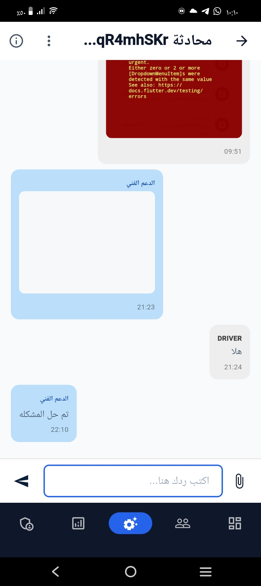
  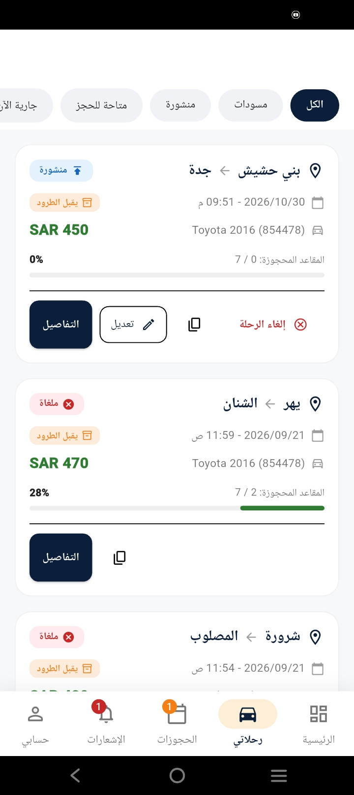
</p>
<table>
  <tr>
    <td align="center"><b>Login</b><br>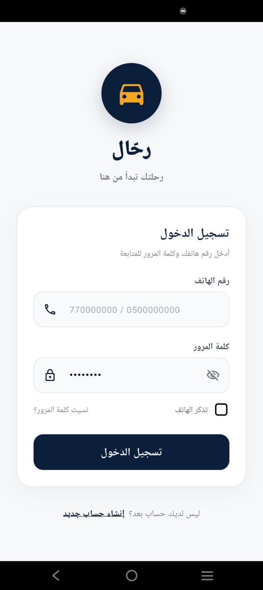</td>
    <td align="center"><b>Trip Search</b><br>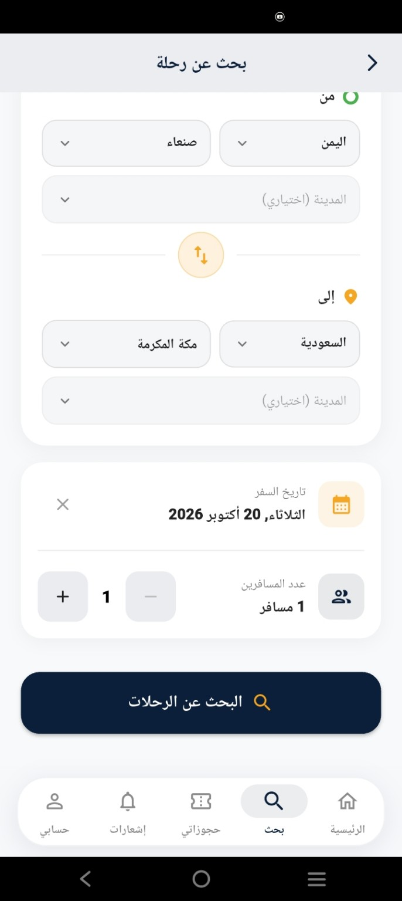</td>
    <td align="center"><b>Seat Selection</b><br></td>
  </tr>
  <tr>
    <td align="center"><b>Booking Management</b><br>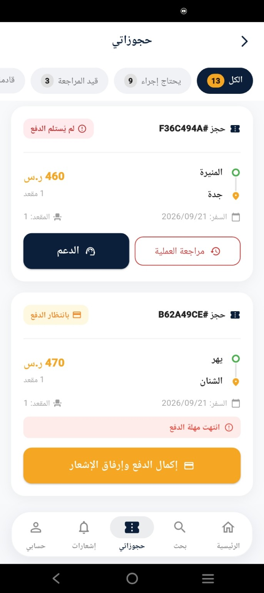</td>
    <td align="center"><b>Driver Trips</b><br>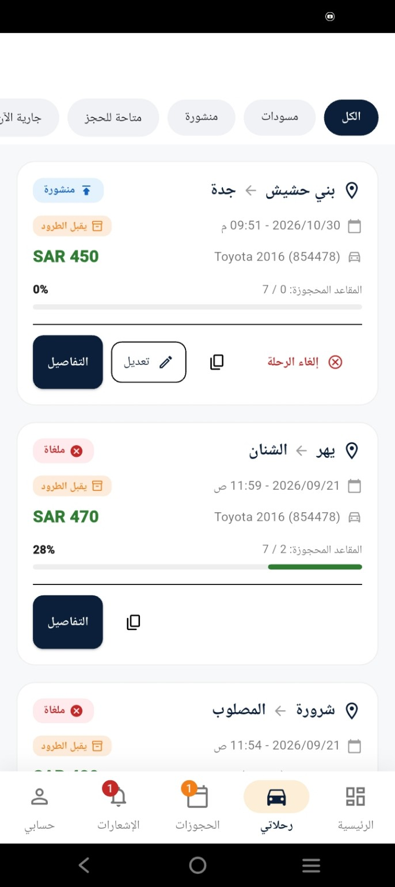</td>
    <td align="center"><b>Create Trip</b><br></td>
  </tr>
  <tr>
    <td align="center"><b>Admin Dashboard</b><br>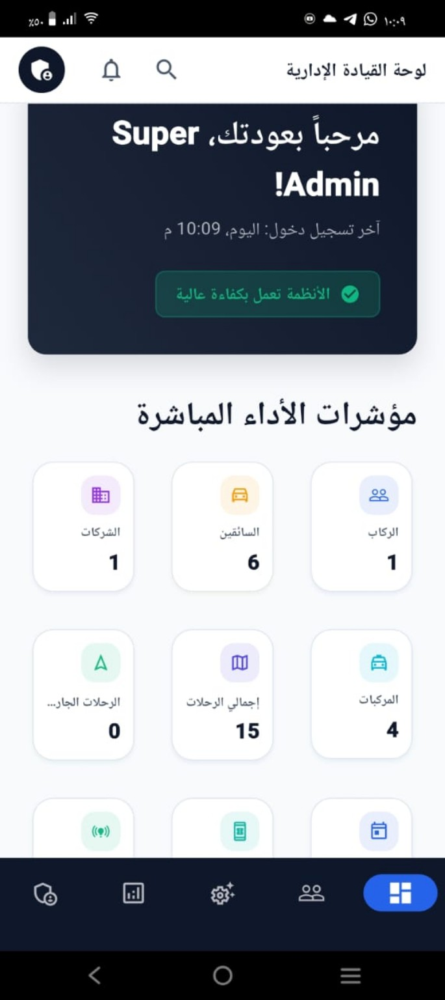</td>
    <td align="center"><b>Admin Quick Actions</b><br>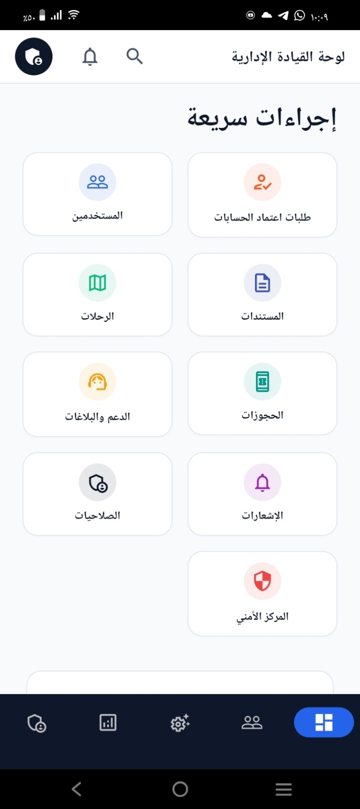</td>
    <td align="center"><b>Notification Center</b><br>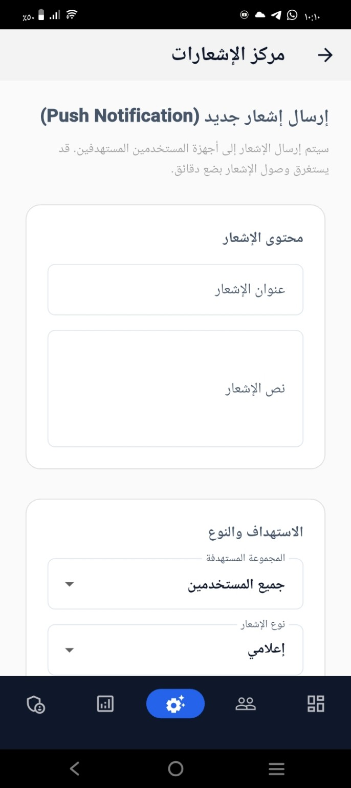</td>
  </tr>
  <tr>
    <td align="center"><b>Support Center</b><br>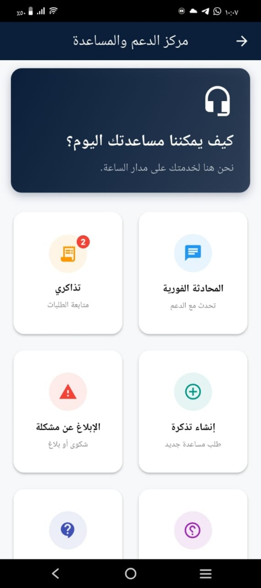</td>
    <td align="center"><b>Settings</b><br>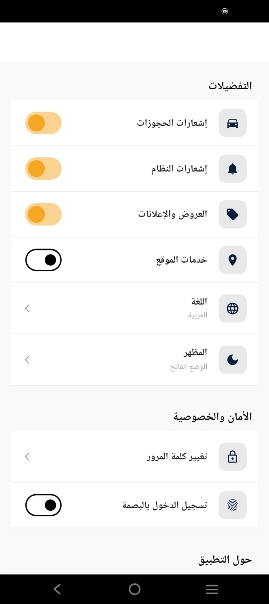</td>
  </tr>
</table>

## Technology Stack

| Layer | Technology |
| --- | --- |
| Mobile client | Flutter / Dart |
| State management | Riverpod |
| Navigation | GoRouter |
| Authentication | Firebase Authentication |
| Primary database | Cloud Firestore |
| Push notifications | Firebase Cloud Messaging |
| Backend automation | Firebase Cloud Functions / TypeScript |
| Storage & server workflows | Supabase |
| Serverless endpoints | Supabase Edge Functions / Deno |
| Localization | Flutter localization (`l10n`) |

## Architecture

The codebase is feature-oriented and separates presentation/state from repositories and remote services where appropriate.

```text
UI / Screens
    │
    ▼
Riverpod Providers / Controllers
    │
    ▼
Repositories / Services
    │
    ├───────────────┐
    ▼               ▼
Firebase         Supabase
Auth / Firestore Storage / Edge Functions
    │               │
    └───────┬───────┘
            ▼
      Application State
```

Representative project structure:

```text
lib/
├── core/
│   ├── config/
│   ├── router/
│   ├── services/
│   └── widgets/
└── features/
    ├── auth/
    ├── trips/
    ├── driver/
    ├── company/
    ├── fleet/
    ├── notifications/
    ├── support/
    ├── wallet/
    └── admin/

functions/src/              # Firebase Cloud Functions
supabase/functions/         # Supabase Edge Functions
firestore.rules             # Firestore authorization rules
firestore.indexes.json
test/
```

## Security & Public-Repository Design

The public repository intentionally does **not** contain live environment secrets or production server credentials.

Client runtime identifiers are supplied through Dart compile-time defines instead of being committed directly:

```text
SUPABASE_URL
SUPABASE_PUBLISHABLE_KEY
FIREBASE_PROJECT_ID
FIREBASE_MESSAGING_SENDER_ID
FIREBASE_STORAGE_BUCKET
FIREBASE_AUTH_DOMAIN
FIREBASE_ANDROID_API_KEY
FIREBASE_ANDROID_APP_ID
FIREBASE_WEB_API_KEY
FIREBASE_WEB_APP_ID
...
```

Sensitive server-side values belong in the deployment environment only:

```text
FIREBASE_SERVICE_ACCOUNT
FIREBASE_PROJECT_ID
SUPABASE_URL
SUPABASE_SERVICE_ROLE_KEY
SUPABASE_SECRET_KEY
SUPABASE_JWT_SECRET
CRON_SECRET
```

The scheduled Supabase maintenance endpoints use **fail-closed** `CRON_SECRET` validation: if the secret is missing or incorrect, the endpoint does not execute the maintenance job.

Firestore rules restrict broad client writes and use ownership/role checks. Financial balance mutation is intentionally treated as a trusted-backend operation rather than a normal client write.

> Security rules and privileged workflows should always be regression-tested against the deployed backend before production rollout.

## Local Configuration

Copy the example runtime configuration and fill it with values from your own Firebase/Supabase projects:

```bash
cp config/dart_defines.example.json config/dart_defines.local.json
```

`config/dart_defines.local.json` is ignored by Git.

Then run:

```bash
flutter pub get
flutter run --dart-define-from-file=config/dart_defines.local.json
```

The production project also uses vehicle seat-map media under `assets/images/vehicles/`. Those non-code media assets are intentionally omitted from this public portfolio snapshot.

## Firebase Functions

```bash
cd functions
npm install
npm run build
```

Deployment secrets/configuration must be supplied through the Firebase environment/secret configuration rather than committed source files.

## Testing

The repository includes Flutter test infrastructure. High-value areas for continued automated coverage include:

- authentication and authorization boundaries
- booking state transitions
- seat reservation concurrency
- payment-verification transitions
- repository/service behavior
- admin-only workflows

## Repository Safety

Do not commit:

- `.env` files
- Firebase Admin service-account JSON
- Supabase service-role/secret keys
- Android signing keys or keystores
- production tokens/passwords
- real identity documents or payment proofs
- production user exports

A defensive `.gitignore` is included, but secret scanning and repository-history review should still be performed before every public release.

## License

This is **not an open-source project**. The source is publicly viewable for portfolio, recruitment, and technical-review purposes only. See [`LICENSE`](LICENSE) for the usage restrictions.

## Project Status

Rahhal is an actively developed portfolio project. This public snapshot focuses on architecture, representative implementation, backend integrations, and product workflows rather than distributing a deployable production environment.
